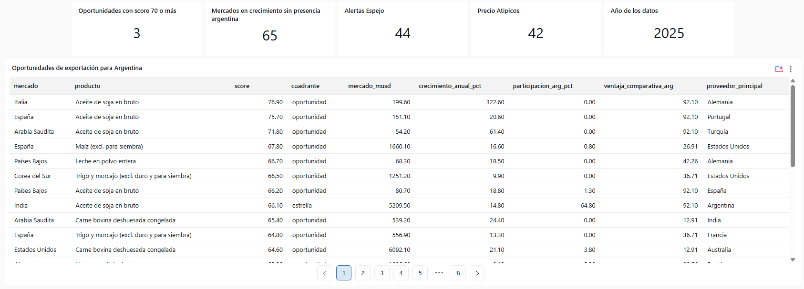
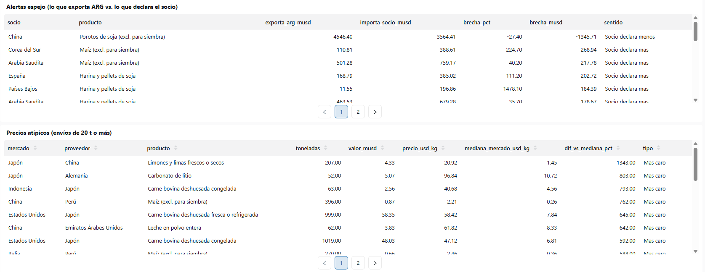
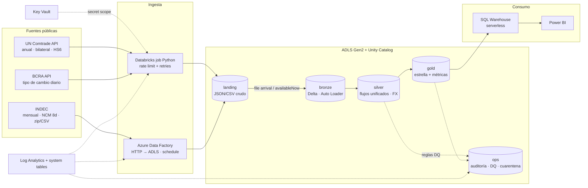

# Radar COMEX Argentina · Oportunidades de exportación con datos 🇦🇷

Plataforma de datos end-to-end sobre **Azure + Databricks** que responde preguntas reales de inteligencia comercial para exportadores argentinos, usando datos públicos oficiales (UN Comtrade, INDEC, BCRA).

> © 2026 Agustin Valenti Boursiac. Todos los derechos reservados. El código, la metodología y la documentación no se pueden copiar ni reutilizar sin permiso escrito. Ver [LICENSE](LICENSE).

> No es un "pipeline de ventas de ejemplo". Cada tabla gold responde una pregunta que hoy un analista de una cámara sectorial, una agencia de promoción (tipo AAICI) o el área comercial de una exportadora resuelve a mano con planillas.

## Estado actual: corriendo en producción liviana

El pipeline completo corre hoy en **Databricks Free Edition** (serverless + Unity Catalog), con datos **reales** de UN Comtrade, y se actualiza solo.

- **Job semanal** (lunes 9:00, Buenos Aires): consulta la disponibilidad de datos en Comtrade, baja solo lo nuevo o revisado y re-corre bronze → silver → gold. Si algo falla, avisa por mail.
- **Dashboard AI/BI "Radar COMEX Argentina"**: oportunidades de exportación, alertas de estadística espejo y precios atípicos, siempre sobre el último año disponible.
- **Resultados con datos 2025**: 65 combinaciones producto-mercado en el cuadrante de oportunidad, 3 con score ≥ 70, 44 alertas espejo (diferencias ≥ USD 1M entre lo que declara Argentina y lo que declara el socio) y 42 precios atípicos.




Los notebooks están en [notebooks/databricks/](notebooks/databricks/). La arquitectura Azure (Terraform, ADF, Key Vault) de más abajo es el diseño objetivo para un entorno corporativo; el código de transformación es el mismo.

## Preguntas de negocio que responde

| # | Pregunta | Tabla gold | Técnica |
|---|----------|-----------|---------|
| 1 | ¿En qué mercados crece la demanda de un producto donde Argentina es competitiva pero tiene poca participación? | `fact_export_opportunity` | Score multicriterio por percentiles + cuadrante estratégico |
| 2 | ¿En qué productos Argentina tiene ventaja comparativa revelada? | `fact_rca` | Índice de Balassa |
| 3 | ¿Quién domina cada mercado y qué tan difícil es entrar? | `fact_market_concentration`, `fact_supplier_share` | HHI, CR3, ranking de proveedores |
| 4 | ¿A qué precio vende Argentina vs. la competencia? ¿Hay precios anómalos? | `fact_unit_value` | Valor unitario USD/kg, robust z-score (MAD) |
| 5 | ¿Lo que Argentina declara exportar coincide con lo que el socio declara importar? | `fact_mirror_gap` | Estadística espejo con ajuste CIF/FOB |
| 6 | ¿Cómo evolucionan las exportaciones mes a mes en USD y en pesos? | `fact_ar_exports_monthly` | INDEC NCM→HS6 + tipo de cambio BCRA |

## Arquitectura



Detalle completo, decisiones y trade-offs: [docs/architecture.md](docs/architecture.md).

## Stack

| Capa | Tecnología |
|------|-----------|
| Infraestructura | Terraform (azurerm + databricks provider), backend remoto en Azure Storage |
| Almacenamiento | ADLS Gen2 (HNS), Delta Lake, Unity Catalog (catálogo por entorno) |
| Ingesta | Azure Data Factory (archivos INDEC), jobs Python (APIs Comtrade con clave o pública, BCRA), Auto Loader |
| Transformación | PySpark empaquetado como wheel, Lakeflow Declarative Pipelines (DLT) como variante |
| Orquestación | Databricks Workflows (Asset Bundles), file-arrival trigger, ADF schedule trigger |
| Calidad | Reglas declarativas compartidas Jobs/DLT, cuarentena, métricas DQ, control de frescura |
| Seguridad | Managed identities (Access Connector, ADF MSI), Key Vault-backed secret scope, grants y row filters UC |
| Observabilidad | Logs JSON → Log Analytics, `ops.pipeline_runs`, system tables (billing, lakeflow), alertas |
| CI/CD | GitHub Actions: lint + tests con Spark + terraform validate; deploy con OIDC (sin secretos) |
| Consumo | Databricks SQL Warehouse serverless + Power BI (DirectQuery / Import) |

## Estructura del repositorio

```
├── conf/                     # Configuración por entorno (base + dev/prod/local)
├── src/trade_intel/
│   ├── ingestion/            # Clientes Comtrade, BCRA; escritura en landing
│   ├── bronze/               # Auto Loader landing → bronze
│   ├── silver/               # Normalización Comtrade + INDEC, FX, dimensiones
│   ├── gold/                 # Métricas (RCA, HHI, CAGR, espejo, precios, score) y modelo estrella
│   ├── quality/              # Reglas de calidad y cuarentena
│   ├── common/               # Spark, TableIO (MERGE idempotente), auditoría, logging
│   └── jobs/                 # Entry points de cada tarea del Workflow
├── notebooks/databricks/     # Versión Databricks Free Edition: pipeline, vistas del dashboard, job semanal
├── pipelines/dlt_silver.py   # Variante declarativa (DLT) reutilizando las mismas reglas
├── resources/                # Jobs y pipelines del Databricks Asset Bundle
├── databricks.yml            # Bundle: targets dev / prod
├── infra/terraform/          # RG, ADLS, Key Vault, Databricks, ADF, Log Analytics, Unity Catalog
├── adf/                      # Linked services, datasets, pipeline y trigger de Data Factory
├── sql/                      # Vistas semánticas, gobierno (tags, row filters), observabilidad
├── powerbi/                  # Modelo, páginas y medidas DAX
├── data/reference/           # Seeds: países (M49/ISO3/INDEC) y productos HS6
├── data/sample/              # Datos SINTÉTICOS con el layout real de cada fuente
├── scripts/                  # Generador de muestra, demo local, corrida completa en Docker, mantenimiento Delta
├── tests/                    # pytest + chispa (unitarios y e2e con Spark local)
└── docs/                     # Arquitectura, roadmap, fuentes, modelo, métricas, runbook, ADRs
```

## Correrlo en local (sin Azure)

Requisitos: Python 3.10+, Java 17 o 21.

```bash
python -m venv .venv && source .venv/bin/activate
make install          # pip install -e ".[dev]"
make test             # 35 tests: métricas, silver, calidad, ingesta y pipeline e2e
make demo             # landing → bronze → silver → gold sobre data/sample e imprime resultados

# Con datos REALES de Comtrade, sin clave (API pública, máx. 500 registros por pedido)
python scripts/fetch_comtrade_public.py --year 2023
python scripts/run_local_demo.py --landing data/public_sample
```

`make demo` imprime el top de oportunidades, las alertas espejo y los outliers de precio. La muestra es **sintética** (generada por `scripts/generate_sample_data.py`) y tiene casos plantados para validar que el pipeline los detecte: subdeclaración ARG→Países Bajos en limones, un precio de vino 12× la mediana en China y filas inválidas que deben ir a cuarentena.

### En Windows con Docker (corrida completa con datos reales)

Spark no corre bien en Windows nativo, así que el pipeline completo se ejecuta dentro de un contenedor. La clave de Comtrade se lee de una variable de entorno y nunca queda en el repo.

```powershell
$env:COMTRADE_API_KEY = Read-Host Clave
docker run --rm -e COMTRADE_API_KEY -v ${PWD}:/work -w /work python:3.12-bookworm python scripts/docker_full_radar.py
```

## Correrlo en Databricks Free Edition

1. Subir un zip con `src/`, `conf/` y `data/reference/` a un volumen (`/Volumes/workspace/comex/archivos/comex.zip`).
2. Importar los notebooks de [notebooks/databricks/](notebooks/databricks/).
3. Correr `comex_guardar_clave` una vez para guardar la clave de Comtrade como secreto.
4. Correr `comex_pipeline` y después `comex_dashboard_vistas.sql`.
5. Programar `comex_actualizar` como job semanal y armar el dashboard sobre las vistas `comex_dash.v_*`.

## Despliegue en Azure

1. **Infra**: `cd infra/terraform && terraform init -backend-config=envs/dev.backend.hcl && terraform apply -var-file=envs/dev.tfvars`
2. **Secreto**: cargar la subscription key de Comtrade en Key Vault (`comtrade-subscription-key`).
3. **Código**: `databricks bundle deploy -t dev` (lo hace el CD en cada push a `main`).
4. **Vistas**: ejecutar `sql/01_semantic_views.sql` y `sql/02_governance.sql` en el catálogo `trade_dev`.
5. **Power BI**: conectar al SQL Warehouse según [powerbi/README.md](powerbi/README.md).

Paso a paso detallado: [docs/guia-paso-a-paso.md](docs/guia-paso-a-paso.md). Operación diaria: [docs/runbook.md](docs/runbook.md).

## Documentación

- **[Guía paso a paso para ejecutarlo por tu cuenta](docs/guia-paso-a-paso.md)**
- [Arquitectura y decisiones](docs/architecture.md)
- [Plan por fases (roadmap)](docs/roadmap.md)
- [Fuentes de datos](docs/data-sources.md)
- [Modelo de datos](docs/data-model.md)
- [Métricas y fórmulas](docs/metrics.md)
- [Runbook operativo](docs/runbook.md)
- ADRs: [medallion + UC](docs/adr/0001-medallion-unity-catalog.md) · [orquestación](docs/adr/0002-orquestacion-adf-workflows.md) · [jobs vs DLT](docs/adr/0003-jobs-pyspark-vs-dlt.md) · [score](docs/adr/0004-score-de-oportunidad.md)

## Derechos de autor y datos

© 2026 Agustin Valenti Boursiac. **Todos los derechos reservados.**

Este repositorio es público para que se pueda **ver** como portfolio. El código, los notebooks, las consultas SQL, la metodología de métricas (score de oportunidad, alertas espejo, precios atípicos), el diseño del dashboard y la documentación son obra del autor. **No se permite copiarlos, modificarlos, redistribuirlos ni usarlos con fines comerciales sin permiso escrito.** Las condiciones completas están en [LICENSE](LICENSE).

**Datos:** las estadísticas de comercio provienen de fuentes **públicas**: [UN Comtrade](https://comtradeplus.un.org/) (Naciones Unidas), y como fuentes complementarias BCRA e INDEC. Esos datos no son propiedad del autor y se rigen por los términos de uso de cada fuente. El repositorio no incluye claves de API ni datos descargados: cada uno debe usar su propia clave de Comtrade.

¿Te interesa usar algo del proyecto? Escribime por LinkedIn o abrí un issue y lo charlamos.
