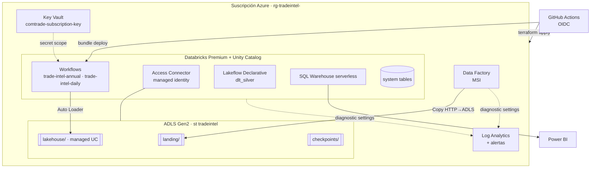

# Arquitectura

## Vista general

## Flujo de datos por capa

| Capa | Contenido | Formato | Escritura | Clave |
|------|-----------|---------|-----------|-------|
| landing | Respuesta cruda de la API / archivo oficial, con envelope de metadata (`_request`, `_fetched_at`, `_truncated`) | JSON / CSV | Overwrite por clave determinística (`comtrade/freq=A/year=2024/reporter=32/flow=X/`) | Ruta |
| bronze | Un registro por fila de origen, sin tipar, + `_source_file`, `_ingest_ts`, `_rescued_data` | Delta | Append incremental (Auto Loader `availableNow`) | — |
| silver | Contrato unificado `trade_flows` (Comtrade + INDEC), `fx_daily`, `fx_monthly`, dimensiones | Delta, particionado `source/year` | MERGE idempotente por clave de negocio | `source, freq, flow, period_date, reporter, partner, hs6` |
| gold | Estrella: `dim_*` + `fact_*` con métricas | Delta, particionado `year` | Overwrite completo (volumen chico, recalcula percentiles) | Ver data-model |
| ops | `pipeline_runs`, `dq_metrics`, `quarantine_trade_flows`, `freshness` | Delta | Append | — |

## Decisiones clave

1. **Landing separado de bronze.** La API de Comtrade tiene cuota diaria. Guardar la respuesta cruda permite re-procesar bronze/silver infinitas veces sin volver a llamar a la API. Ver [ADR 0001](adr/0001-medallion-unity-catalog.md).
2. **ADF sólo para archivos, Python para APIs.** ADF resuelve bien "bajar un zip y descomprimirlo" sin código; las APIs con paginación, cuota y rate limit se manejan mejor en Python testeable. Ver [ADR 0002](adr/0002-orquestacion-adf-workflows.md).
3. **Lógica de negocio en un paquete, no en notebooks.** Toda transformación es una función `DataFrame -> DataFrame` con tests. Los jobs son entry points finos. DLT reutiliza las mismas funciones. Ver [ADR 0003](adr/0003-jobs-pyspark-vs-dlt.md).
4. **Idempotencia en todas las capas.** Claves determinísticas en landing, checkpoints en bronze, MERGE por clave de negocio en silver, overwrite en gold. Re-correr cualquier tarea no duplica datos.
5. **Calidad como contrato, no como reporte.** Reglas con severidad (`drop`/`warn`/`fail`): las filas inválidas van a cuarentena con el motivo; las violaciones críticas frenan el job antes de contaminar gold.
6. **Seguridad sin secretos en código.** Storage sin shared keys, identidades administradas para Databricks y ADF, OIDC federado para GitHub, Key Vault para la única credencial externa (Comtrade).
7. **Un catálogo por entorno** (`trade_dev`, `trade_prod`) con mismo nombre de schemas: el código no cambia entre entornos, sólo la config.

## Entornos

| | dev | prod |
|---|---|---|
| Catálogo | `trade_dev` | `trade_prod` |
| Storage | LRS | ZRS |
| Bundle mode | development (prefijo por usuario, schedules pausados) | production (run_as service principal) |
| Comtrade años | 3 | 6 |
| Deploy | push a `main` | tag `v*` + aprobación manual |
| Warehouse | 2X-Small, 1 cluster | Small, hasta 3 clusters |

## Costos (orden de magnitud)

Volumen esperado: ~20 reporters × 15 productos × 6 años ≈ decenas de miles de filas en silver. El costo lo dominan el cómputo de jobs y el warehouse, no el storage. Palancas: job clusters efímeros con autoscale 1-4, warehouse serverless con auto-stop 10 min, landing a tier cool a los 30 días, Photon sólo en el job anual.
