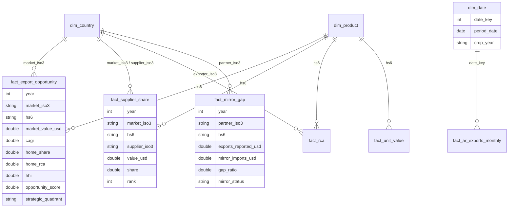

# Modelo de datos

## Silver

### `silver.trade_flows` (contrato unificado)

| Columna | Tipo | Descripción |
|---------|------|-------------|
| source | string | `comtrade` \| `indec` |
| freq | string | `A` anual \| `M` mensual |
| flow | string | `X` exportación \| `M` importación |
| period_date | date | Primer día del período |
| year, month | int | `month` nulo en anuales |
| reporter_iso3 | string | País que declara |
| partner_iso3 | string | Socio (`WLD` = mundo) |
| hs6 | string | Producto HS6 o `TOTAL` |
| trade_value_usd | double | Valor primario (FOB en X, CIF en M) |
| fob_value_usd, cif_value_usd | double | Cuando la fuente los informa |
| net_weight_kg | double | Peso neto |
| unit_value_usd_kg | double | `trade_value_usd / net_weight_kg` |
| _ingest_ts | timestamp | Para resolver duplicados en el MERGE |

Clave de negocio: `source, freq, flow, period_date, reporter_iso3, partner_iso3, hs6`.

## Gold (estrella)

| Tabla | Grano | Uso |
|-------|-------|-----|
| `dim_country` | país | Región, bloque comercial, códigos M49/INDEC |
| `dim_product` | HS6 | Descripción, sector, HS2/HS4 para jerarquías |
| `dim_date` | mes | Trimestre, semestre, **campaña agrícola** (jul-jun) |
| `fact_trade_annual` | año × flujo × reporter × socio × HS6 | Base de todo el análisis |
| `fact_supplier_share` | año × mercado × HS6 × proveedor | Competidores |
| `fact_market_concentration` | año × mercado × HS6 | HHI, CR3, CAGR |
| `fact_rca` | año × exportador × HS6 | Ventaja comparativa |
| `fact_unit_value` | año × mercado × HS6 × proveedor | Precios y outliers |
| `fact_mirror_gap` | año × socio × HS6 | Consistencia de declaraciones |
| `fact_export_opportunity` | año × mercado × HS6 | Radar (score + cuadrante) |
| `fact_ar_exports_monthly` | mes × socio × HS6 | Serie INDEC en USD y ARS |

## Ops

| Tabla | Contenido |
|-------|-----------|
| `ops.pipeline_runs` | run_id, task, status, duración, filas, error |
| `ops.dq_metrics` | Violaciones por regla y corrida |
| `ops.quarantine_trade_flows` | Filas rechazadas + `_dq_failed` (motivos) |
| `ops.freshness` | Edad de cada fuente vs. SLA |
