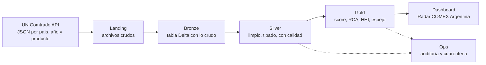
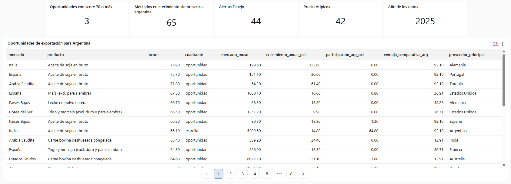
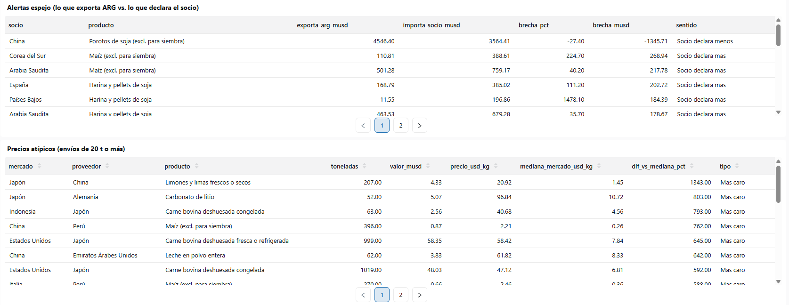

# Radar COMEX Argentina: cómo lo construí

*Por Agustin · noviembre de 2026*

## Resumen

Construí una plataforma de datos que detecta **oportunidades de exportación para Argentina** usando datos públicos de comercio internacional (UN Comtrade). Hoy corre sola en Databricks, se actualiza todos los lunes y está publicada en GitHub.

La pregunta que responde: *¿en qué mercados crece la demanda de productos donde Argentina es competitiva, pero todavía vende poco?* Además marca dos tipos de alertas: diferencias entre lo que Argentina dice que exportó y lo que el otro país dice que importó (estadística espejo), y precios que se salen de lo normal.

El recorrido completo, en orden:

1. Preparar la PC: Python, Spark y Docker como motor.
2. Probar el pipeline en local con una muestra pública de Comtrade.
3. Conseguir la clave de Comtrade y bajar los datos completos (20 países, 15 productos, 2019 a 2024).
4. Procesar los datos con la arquitectura **medallion** (bronze, silver, gold).
5. Llevar todo a **Databricks Free Edition**: notebooks, dashboard y un job semanal automático.
6. Subir el proyecto a **GitHub** por partes, con ramas y Pull Requests.

Es una versión **educativa y gratuita**. El diseño corporativo (Azure, Terraform, CI/CD) está escrito en el repo, pero queda para cuando haya una suscripción de Azure.

## Tecnologías: versión educativa vs. corporativa

Todo lo que usé es **gratis**. La columna corporativa es lo que ya está diseñado en el repo para una empresa, pero todavía no lo puse en marcha.

| Para qué | Lo que usé (educativo) | Equivalente corporativo |
| --- | --- | --- |
| Lenguaje | Python 3.12 | Igual |
| Procesar datos | Apache Spark (PySpark) | Igual |
| Formato de tablas | Delta Lake | Igual |
| Correr en la PC | Docker Desktop con la imagen `python:3.12-bookworm` | Clúster de Databricks en Azure |
| Nube | Databricks Free Edition (serverless) | Azure Databricks + Azure Data Lake (ADLS Gen2) |
| Catálogo y permisos | Unity Catalog, catálogo `workspace` | Unity Catalog con un catálogo por entorno (dev y prod) |
| Archivos | Volumes de Databricks | ADLS Gen2 |
| Claves | Secreto de Databricks `comex/comtrade` | Azure Key Vault |
| Automatización | Job de Databricks (lunes 9:00) | Databricks Workflows + Azure Data Factory |
| Visualización | Dashboard AI/BI de Databricks | Power BI |
| Infraestructura | Creada a mano en la web | Terraform (infraestructura como código) |
| Versionado | Git + GitHub, PRs manuales | GitHub Actions: tests y despliegue automático (CI/CD) |
| Datos | UN Comtrade (API gratis, ~500 llamadas por día) | Igual, o un plan pago |

**Por qué no corporativo todavía:** la cuenta de Azure de mi trabajo no tiene ninguna suscripción activa, y sin suscripción no se puede crear nada en Azure. Databricks Free Edition da casi lo mismo para aprender, sin costo. La diferencia está en lo que necesita una empresa: varios entornos, permisos finos, infraestructura reproducible con Terraform y despliegues automáticos.

## Paso 1: preparar la PC (y por qué terminé en Docker)

Terminé corriendo el proyecto dentro de **Docker**, porque Spark no funcionó directo en Windows y Ubuntu (WSL) se colgó al instalarse.

1. **Python y dependencias.** Instalé Python y las librerías del proyecto (`pyproject.toml`: PySpark, Delta Lake, requests, pytest, etc.).
2. **Spark en Windows nativo: falló.** Spark necesita Java y lanza procesos de Python aparte (los *workers*). En Windows esos workers se caían (error `EOFException`) y el pipeline no terminaba.
3. **Ubuntu con WSL: se colgó.** WSL permite tener Linux dentro de Windows. La instalación de Ubuntu quedó trabada en "provisioning". Probé desregistrarlo y reinstalarlo, sin éxito, y lo abandoné.
4. **Docker Desktop: funcionó.** Docker corre un mini Linux aislado (un *contenedor*) a partir de una *imagen*. Usé `python:3.12-bookworm` (Debian con Python) y le agregué Java (`default-jre-headless`). Adentro, Spark anda igual que en un servidor.
5. **Red 2.4 GHz.** La red de 5 GHz / corporativa bloqueaba las descargas de `docker.io`. Me pasé a la red de 2.4 GHz y bajé la imagen sin problema.

El comando que lo corre todo monta la carpeta del proyecto dentro del contenedor (`-v ${PWD}:/work`) y le pasa la clave por variable de entorno, sin escribirla en ningún archivo:

```powershell
$env:COMTRADE_API_KEY = Read-Host Clave
docker run --rm -e COMTRADE_API_KEY -v ${PWD}:/work -w /work python:3.12-bookworm python scripts/docker_full_radar.py
```

**Primera prueba local**, con la API pública de Comtrade (sin clave, máximo 500 filas por pedido): bronze 4.314 filas, silver 1.047 y gold 1.995. Me sirvió para comprobar que el pipeline funcionaba de punta a punta.

## Paso 2: los datos de UN Comtrade

Con la clave gratuita de Comtrade bajé **20 países, 15 productos y 6 años (2019 a 2024)** en unas 360 llamadas, dentro del límite de ~500 por día.

- **Qué es Comtrade:** la base de comercio internacional de Naciones Unidas. Cada país informa cuánto exportó e importó, de qué producto, a quién, en dólares y en kilos.
- **Productos:** se identifican con el código **HS6** (6 dígitos). Elegí 15 con foco exportador argentino: carne bovina, langostinos, limones, maíz, trigo, maní, soja, aceite y harina de soja, vino, leche en polvo, carbonato de litio, entre otros.
- **Países:** Argentina y 19 mercados (Brasil, China, Estados Unidos, Alemania, España, Italia, Países Bajos, Chile, México, India, Japón, Corea, Rusia, Emiratos, Arabia Saudita, Vietnam, Indonesia, Egipto, Sudáfrica).
- **API pública vs. con clave:** la pública no pide registro pero corta en 500 filas. La clave (plan gratis) permite hasta 100.000 filas por pedido.
- **Cuidado con la clave:** nunca se pega en el chat ni en el código. En la PC se carga con `Read-Host` en la variable `COMTRADE_API_KEY`; en Databricks se guarda como secreto.

El script `scripts/fetch_comtrade_public.py` hace los pedidos, respeta el límite de velocidad y guarda las respuestas JSON en la carpeta *landing* (los datos crudos, tal cual llegan).

## Paso 3: la arquitectura medallion

Los datos pasan por tres capas, y cada una los deja más limpios y más útiles: **bronze** guarda lo crudo, **silver** lo limpia y **gold** calcula las respuestas de negocio. Una cuarta zona, **ops**, registra cómo salió cada corrida.



La ventaja: si algo sale mal en gold, no hace falta volver a llamar a la API, porque bronze conserva todo lo que llegó. Todas las tablas están en formato **Delta**, que permite actualizar filas (MERGE) sin duplicar y volver a versiones anteriores.

| Capa | Tablas que creé | Qué tienen | Filas con datos completos |
| --- | --- | --- | --- |
| Landing | Carpeta de archivos | JSON de Comtrade tal cual llegaron | — |
| Bronze | `comtrade_raw` (y `bcra_fx_raw`, `indec_*_raw` en el diseño completo) | Lo crudo + de qué archivo y cuándo se cargó | 111.403 |
| Silver | `trade_flows`, `fx_daily`, `dim_country`, `dim_product` | Flujos de comercio normalizados (país, producto, año, USD, kg), tipos de cambio y tablas de referencia | 37.086 |
| Gold | `fact_trade_annual`, `fact_export_opportunity`, `fact_rca`, `fact_market_concentration`, `fact_supplier_share`, `fact_unit_value`, `fact_mirror_gap`, `dim_date` | Modelo estrella con las métricas de negocio | 74.625 |
| Ops | `pipeline_runs`, `quarantine_trade_flows` | Cada corrida (cuándo, cuántas filas, si falló) y las filas rechazadas por calidad | — |

**Reglas de calidad (silver):** si una fila viene sin país, con valor negativo o con código de producto inválido, no se descarta en silencio: va a una tabla de **cuarentena** para revisarla.

El código de cada capa está en `src/trade_intel/` (`bronze/`, `silver/`, `gold/`, `quality/`).

## Paso 4: qué calcula la capa gold

Gold convierte millones de números de comercio en respuestas concretas. La principal es el **score de oportunidad** (0 a 100) de cada par producto-mercado.

| Métrica | Pregunta que responde | Cómo se calcula, en simple | Tabla |
| --- | --- | --- | --- |
| Score de oportunidad | ¿Dónde conviene salir a vender? | Promedio ponderado de percentiles: crecimiento del mercado 25%, tamaño 20%, ventaja de Argentina (RCA) 20%, espacio libre (lo que ARG todavía no vende) 15%, mercado poco concentrado 10%, precio competitivo 10% | `fact_export_opportunity` |
| Cuadrante | ¿Qué tipo de mercado es? | *Oportunidad* = crece y ARG vende poco; *estrella* = crece y ARG es fuerte; *defender* = no crece y ARG es fuerte; *monitorear* = el resto | `fact_export_opportunity` |
| RCA (índice de Balassa) | ¿Argentina es buena en este producto? | Peso del producto en las exportaciones argentinas dividido su peso en el comercio mundial. Mayor a 1 = ventaja | `fact_rca` |
| HHI y CR3 | ¿Qué tan difícil es entrar? | Cuánto se concentra el mercado en pocos proveedores | `fact_market_concentration`, `fact_supplier_share` |
| Valor unitario | ¿A qué precio vendemos? ¿Hay precios raros? | USD por kilo, y se marca *atípico* si se aleja mucho de la mediana (z-score robusto) | `fact_unit_value` |
| Estadística espejo | ¿Coincide lo que ARG declara con lo que declara el socio? | Exportación ARG vs. importación del socio, ajustando flete y seguro (CIF/FOB) | `fact_mirror_gap` |

**Por qué percentiles:** las variables tienen escalas muy distintas (dólares, porcentajes, índices). El percentil las pone a todas en la misma escala y es fácil de explicar: *"este mercado está en el 10% que más crece"*. La decisión está documentada en `docs/adr/0004-score-de-oportunidad.md`.

## Paso 5: todo lo que armé en Databricks

En **Databricks Free Edition** el pipeline corre en la nube, se actualiza solo cada lunes y alimenta un dashboard. Todo es *serverless*: no hay que prender ni apagar servidores.

**Conceptos de Databricks que usé**

- **Unity Catalog:** organiza los datos en `catálogo.esquema.tabla`. Usé el catálogo `workspace` con los esquemas `comex_bronze`, `comex_silver`, `comex_gold`, `comex_ops` y `comex_dash`.
- **Volume:** una carpeta de archivos dentro del catálogo. Ahí subí el código y los datos: `/Volumes/workspace/comex/archivos/comex.zip`.
- **Notebook:** un archivo con celdas de código que se ejecutan en orden.
- **Secreto:** un valor cifrado (la clave de Comtrade) que el código puede leer pero nadie puede ver.
- **Job:** un notebook programado para correr solo.
- **Dashboard AI/BI:** tableros visuales hechos con consultas SQL.

**Lo que hice, en orden**

1. **Subir el proyecto:** armé un zip con `src/`, `conf/` y `data/` y lo subí al Volume.
2. **`comex_pipeline`:** descomprime el zip, carga los JSON y corre bronze, silver y gold. Tuve que parchear `df.cache()`, porque serverless no lo permite.
3. **`comex_dashboard_vistas.sql`:** crea 4 vistas en `comex_dash` (`v_oportunidades`, `v_alertas_espejo`, `v_precios_atipicos`, `v_resumen`). Siempre muestran el último año, así el dashboard se actualiza solo.
4. **Dashboard "Radar COMEX Argentina":** página *Resumen* (4 contadores, entre ellos el año de los datos, y la tabla de oportunidades) y página *Alertas* (espejo y precios atípicos). Se refresca todos los lunes a las 10:00.
5. **`comex_test_internet`:** comprobó que Databricks puede llegar a la API de Comtrade (Free Edition limita internet a dominios de confianza).
6. **`comex_guardar_clave`:** guardó la clave como secreto `comex/comtrade`, sin que quede escrita en ningún lado.
7. **`comex_actualizar` + job semanal:** cada lunes a las 9:00 pregunta a Comtrade qué datos hay disponibles, los compara con lo que ya tenía (`comex_ops.comtrade_disponibilidad`), baja solo lo nuevo o revisado y re-corre el pipeline. Si algo falla, el job falla a propósito y me llega un mail.

**Resultado:** la primera corrida automática bajó los datos **2025** y el dashboard los muestra: 65 pares en el cuadrante oportunidad, 3 con score mayor o igual a 70, 44 alertas espejo (diferencias de USD 1 millón o más) y 42 precios atípicos.




**Límites de Free Edition:** un solo SQL warehouse chico, hasta 5 tareas de job a la vez, internet restringido y una cuota diaria de cómputo (si se pasa, se apaga hasta el día siguiente).

## Paso 6: publicarlo en GitHub

El proyecto está público en [github.com/agusvalenti59/trade-intelligence-platform](https://github.com/agusvalenti59/trade-intelligence-platform), subido en 4 partes, cada una con su rama y su Pull Request.

| Parte | Rama | Qué subió | Cómo |
| --- | --- | --- | --- |
| 1 | `main` | Código base, ingesta, pipeline, tests y documentación (los 3 commits que ya existían) | `git push` directo |
| 2 | `parte-2-docker-local` | Script de Docker, descarga con clave y `.gitignore` | PR + Merge |
| 3 | `parte-3-databricks` | Los 5 notebooks de Databricks | PR + Squash and merge |
| 4 | `parte-4-readme` | README nuevo con resultados y capturas del dashboard | PR + Merge |

**Los conceptos de git que aprendí, en una línea cada uno**

- **Repositorio:** la carpeta del proyecto con todo su historial.
- **Commit:** una "foto" guardada de los archivos, con un mensaje que explica el cambio.
- **Remote (`origin`):** la dirección del repositorio en GitHub.
- **Push / pull:** subir commits a GitHub / bajar los cambios de GitHub a la PC.
- **Rama:** una copia de trabajo aparte; `main` no se toca hasta aprobar el cambio.
- **Pull Request:** pedir permiso para unir una rama a `main`, mostrando qué cambia.
- **Squash and merge:** junta todos los commits de la rama en uno solo y deja editar el mensaje.

**El ciclo para cualquier cambio futuro**

```powershell
git switch main
git pull
git switch -c nombre-del-cambio
git add archivos
git commit -m "Mensaje sin tildes"
git push -u origin nombre-del-cambio
```

Después se abre el PR en GitHub, se revisa en *Files changed* y se hace *Merge*.

**Qué NO se sube nunca:** la clave de Comtrade, archivos `.env`, los datos descargados (`data/full_sample/`) y las carpetas temporales de Spark (`_local_lake`, `metastore_db`, `spark-warehouse`). Todo eso está en `.gitignore`.

## Problemas que resolví y qué sigue

Casi todos los problemas fueron de entorno, no del código. Esta tabla sirve como guía rápida si vuelven a aparecer.

| Problema | Causa | Solución |
| --- | --- | --- |
| Spark se cae en Windows (`EOFException`) | Los workers de Python de Spark no funcionan bien en Windows nativo | Correr todo en Docker |
| Ubuntu (WSL) colgado en "provisioning" | Falla de la instalación de WSL en esa PC | Abandoné WSL y usé Docker |
| Docker no baja la imagen | La red 5 GHz / corporativa bloquea `docker.io` | Conectarse a la red 2.4 GHz |
| Comandos que fallan al pegarlos | Las comillas se vuelven "curvas" al copiar del chat | Usar comandos sin comillas |
| `LOCATION_ALREADY_EXISTS` | Quedaban carpetas de corridas anteriores (`_local_lake`, `metastore_db`, `spark-warehouse`) | Borrarlas antes de volver a correr |
| `df.cache()` no soportado | Databricks serverless no permite cache | El notebook lo parchea |
| Mensaje de commit con tildes rotas | PowerShell 5 rompe las tildes | Mensajes sin tildes, o corregirlo en *Squash and merge* |
| Notebooks duplicados con "(1)" | Había copias viejas en Descargas | Borrar, volver a descargar y verificar tamaños |
| Texto rojo `NativeCommandError` | PowerShell muestra como error los mensajes normales de git | Ignorarlo si la última línea dice que salió bien |

**Qué queda para la versión corporativa** (todo ya está diseñado en el repo, en `infra/terraform/`, `adf/` y `.github/workflows/`):

- Una suscripción de Azure habilitada por TI.
- Crear la infraestructura con Terraform: Data Lake, Key Vault, Databricks, Data Factory y monitoreo.
- Sumar las fuentes INDEC (exportaciones mensuales) y BCRA (tipo de cambio).
- CI/CD con GitHub Actions: tests automáticos en cada PR y despliegue sin claves (OIDC).
- Power BI conectado al SQL Warehouse.
